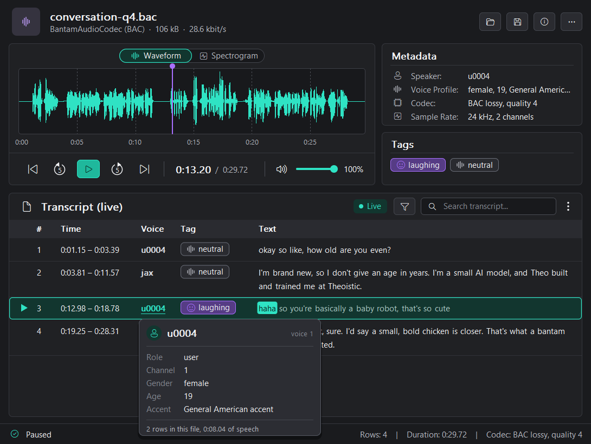

# BAC, the Bantam Audio Codec

A file format for voice: the audio, and in the same file what is said, who says it, and what the voice is doing
when. Made for training speech recognition and speech synthesis, and for listening.

- **Small.** Lossy at 7 to 50 kbit/s, or lossless at about 5 % under FLAC. One bitstream does both.
- **Streams.** A file plays while it arrives, a listener can join a live stream, damage costs one second.
- **Labelled.** Transcript, word and phone alignment, speakers with voice profiles, and range tags such as
  `whisper`, `laughing` or `singing`, all on the audio's time line.
- **Exact.** The decoder is integer arithmetic: every machine gets the same samples, also from lossy files.
- **One program.** `bac.exe` (1.2 MB) is the previewer window and the command-line tool. Rust, no dependencies,
  8,100 lines.

State: version 0, a working draft made on 2026-11-21. The format may still change (docs/Format.md says where).
The lossy mode has not been through a listening test or a word-error test yet: its quality is known from numbers.

BAC is the audio format of the Bantam speech models, and a project of its own.

## Install

**The program.** `bac-setup-…-x86_64.exe` from the [releases](https://github.com/Theoistic/BantamAudioCodec/releases)
installs `bac.exe` for the current user (no administrator needed): a Start menu entry, `.bac` files opening in the
previewer, and `bac` on the PATH, each of the last two a box to tick. The same release has `bac.exe` alone in a zip,
and builds for Linux and macOS; there the previewer window is not there yet and `bac` is the command-line tool.

**The library**, in Rust, from [crates.io](https://crates.io/crates/bantam-audio-codec):

```toml
[dependencies]
bantam-audio-codec = "0.1"                # the crate is named `bac` in code
```

```rust
let pcm = bac::pcm::read_wav(&std::fs::read("talk.wav")?)?;
let opts = bac::EncOpts { quality: 4.0, ..Default::default() };   // or lossless: true
let file = bac::encode(&pcm, &opts, &bac::Labels::default())?;
let (head, labels, back) = bac::decode(&file)?;
```

## The previewer



`bac talk.bac`, a double click on a `.bac` file opened with `bac.exe`, or a file dropped on the window. It plays the
file and lights up the word being said; the row being heard has a frame, and the transcript follows the sound while
"Live" is on. A click on a word, a row or the waveform plays from there. A click on a tag shows only the rows that
have it; the search box filters by text. WAV and FLAC files open too (they have no labels).

Every row names its voice. Rest the mouse on the name and a card shows what the file says about that voice: its
description, every attribute, and how much it speaks in this file. The information button (or Ctrl+I) turns the
transcript into a sheet of the file's details (format, size, packets, labels, attributes, voices) and back.

| | |
|---|---|
| Space | play or pause |
| Left, Right | 5 seconds back, on |
| Up, Down | the row before, after |
| Home, End | the start, the end |
| Ctrl+O, Ctrl+S, Ctrl+I | open, save the sound as WAV, the file's details |
| Ctrl+F, Esc | search; clear search and filter |

Word times are the file's `word` tier. Words the tier does not have, or a file without one, get their time from
the row's time by the length of the words; the head of the transcript then says "word times are estimates".

Started from a shell, the shell waits until the window is closed (`start bac talk.bac` does not wait). Started by a
double click, the program closes the console window Windows gives it; it shows for a moment.

## Use

```bash
cargo build --release                # gives target/release/bac

bac encode talk.flac                 # -> talk.bac, quality 4 (about 22 kbit/s at 16 kHz)
bac encode talk.wav --lossless       # bit for bit
bac encode talk.wav -q 6 --speaker "jax:style=dry and calm" --by jax --text "all=Well, that went well."

bac join chapter.json -o chapter.bac --mono      # many recordings in a row in one file, each a row of the transcript

bac label talk.bac --tag 1.2-2.31=laughing --event word:0.31-0.58=that   # audio is copied, not coded again
bac label talk.bac --export labels.json                                  # edit by hand, then --import
bac info talk.bac
bac decode talk.bac --from 1.2 --to 2.31 -o laugh.wav
bac decode talk.bac -o - | ffplay -autoexit -nodisp -                    # plays as it streams
bac play talk.bac --snapshot shot.png --at 4.5                           # the previewer as a picture, no window
```

Bantam's data preparation reads `.bac` files as it reads FLAC and WAV; a lossless file gives the same training data
as the FLAC of the same recording, byte for byte. A manifest entry can name a part of a file,
`{"files": ["chapter.bac"], "from": 2.09, "to": 6.08, "channel": 1}`: an utterance out of a chapter, a turn out of
a conversation. Its speech sets are kept this way: LibriSpeech as one file per chapter and LJSpeech as one per
session, with an index line per utterance.

`bac help` lists everything. The pipe into a player works in cmd and bash; PowerShell 5 treats a pipe as text and
breaks it, so decode to a file there. `bac info` on a conversation of the jax set (`tools/import_jax.py`):

```text
conversation-q4.bac: BAC, 24000 Hz, 2 channels, 16 bits, lossy, quality 4
29.72 s (713280 samples), 106233 bytes, 28.6 kbit/s; audio 104558 bytes in 60 packets (30 key), labels 1462 bytes
speakers
  1 u0004  (role=user, channel=1, gender=female, age=19, accent=General American accent)
  2 jax  (role=assistant, channel=2)
text
      1.15 -     3.39 [u0004]  okay so like, how old are you even?
      3.81 -    11.57 [jax]  I'm brand new, so I don't give an age in years. I'm a small AI model, and ...
word
      1.15 -     1.59 [u0004]  Okay,
      1.59 -     1.69 [u0004]  so
      ...
tag
     12.98 -    13.52 [u0004]  laughing
```

That file holds what the set keeps as four FLAC files and a JSON file: 106 kB against 686 kB; the lossless version
is 632 kB. The `laughing` tag was added by hand to show a range tag; everything else is from the set's transcript.

## Size and quality

16 kHz mono, the same clips through every codec (docs/Research.md has the full tables and what the numbers mean):

| | LibriSpeech, MB/hour | jax voice, MB/hour | |
|---|---:|---:|---|
| WAV | 115.2 | 115.2 | |
| FLAC, level 12 | 62.8 | 64.6 | without the 8 kB padding block ffmpeg puts in every file |
| `bac --lossless` | 60.1 | 61.1 | exact; 4.4 % and 5.4 % under FLAC |
| `bac -q 6` | 15.8 | 16.3 | error at about the masking threshold (noise-to-mask ratio 0 dB) |
| `bac -q 4` (default) | 9.9 | 10.3 | by noise-to-mask ratio like Opus at 15 to 18 kbit/s, at 22 kbit/s |
| `bac -q 3` | 7.1 | 7.4 | |
| `bac -q 2` | 4.7 | 4.9 | |

On these numbers the lossy mode is level with Opus at about 30 kbit/s and above, and behind it below. It encodes
200 times faster than real time and decodes 1,700 times faster, on one core.

To hear it: `samples/` (not in git; made with `tools/import_jax.py --lossless` and `bac encode -q N`) has one
conversation as `conversation-original.wav` and `conversation-q2.wav` to `-q6.wav`.

## How it works

Linear prediction, as in FLAC and in the speech layer of Opus. A predictor per 20 ms says what each sample will
be from the 16 before it, a pitch predictor adds what the voice did one period ago, and what is left is rounded
to a step and coded by an adaptive range coder (the kind AV1 uses). The step is the quality: at step 1 nothing is
lost. In lossy mode the encoder puts the rounding noise under the voice's formants, and codes the background
between words as noise of the right colour and level. Around the audio is a stream of checksummed units; labels
are units of their own.

## In this repository

| | |
|---|---|
| `crates/bac/` | the library (crate `bantam-audio-codec`): `codec.rs` (bitstream, decoder), `encoder.rs`, `range.rs`, `lpc.rs`, `container.rs`, `labels.rs`, WAV and FLAC readers, `metrics.rs`. 30 tests |
| `crates/bac-player/` | the previewer, part of `bac.exe` (not published): `doc.rs` (rows and word times), `view.rs` (drawing, clicks, keys), `canvas.rs`, `surface.rs`, `audio.rs`, `window.rs`, `icon.rs`. Win32 and GDI text, software drawing. Windows only so far. 12 tests |
| `crates/bac-cli/` | the `bac` program (not published): the commands, and the previewer when no command is given |
| `installer/bac.iss` | the Windows installer (Inno Setup) |
| `.github/workflows/` | `ci.yml` builds and tests on Windows, Linux and macOS; `release.yml` turns a tag `vX.Y.Z` into a GitHub release with the installer and the programs, and publishes the library to crates.io |
| `docs/Format.md` | the format, complete enough to write a second decoder from |
| `docs/Research.md` | the codecs looked at, why Opus, FLAC and AV1 are the templates, measurements, tuning record, what is next |
| `tools/compare_codecs.py` | BAC next to FLAC, Opus, MP3 and Vorbis on the same clips (needs ffmpeg) |
| `tools/import_jax.py` | one conversation of the Bantam-Voice jax set, with its transcript, into one BAC file |

## Not there yet

Listening tests and word error rates through the codec. Recording live, and editing labels in the previewer (it
shows them; `bac label` changes them). The previewer decodes a whole file when it opens it, which is right for
minutes and slow for hours. Two channels coded jointly (two equal channels already cost one). A track of model
tokens beside the audio. The reference encoder is a first one: Research.md lists what a better one would do, in
the same format.

## Release

The version is `version` in the root `Cargo.toml`. Raise it, commit, then

```bash
git tag v0.1.1
git push origin v0.1.1
```

The tag builds `bac` for Windows, Linux and macOS and the Windows installer, makes the GitHub release with them, and
publishes `bantam-audio-codec` to crates.io (with the repository secret `CARGO_REGISTRY_TOKEN`). The player and the
command line are one program, `bac.exe`, and are released only on GitHub. Run by hand (Actions, release, Run
workflow), the same workflow builds everything and keeps it as the run's artifacts, without releasing.

## License

Copyright Theodor Solbjorg (Theoistic). MIT or Apache 2.0, at your choice: [LICENSE-MIT](LICENSE-MIT),
[LICENSE-APACHE](LICENSE-APACHE).
